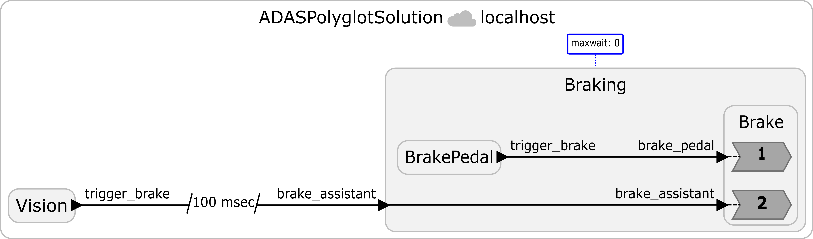

# 10 Coordination of Distributed Cyber-Physical Systems
The purpose of this exercise is to learn about the challenges in coordinating distributed nodes in cyber-physical systems, including the fundamental tradeoff among consistency, availability, and latency described by the [CAL theorem](https://doi.org/10.1145/3609119). In this exercise, we are not using the Pololu robot.


## 10.1 Prelab

**Questions**

<style type="text/css">
    ol ol { list-style-type: lower-alpha; }
</style>

1. Read the first seven paragraphs of the Introduction of the paper ["Consistency vs. Availability in Distributed Cyber-Physical Systems"](https://doi.org/10.1145/3609119).
    1. Consider a warehouse where multiple distributed robots work together. Since the aisles are narrow, the robots share information about aisle occupancy to avoid collisions or blocking each other. Therefore, it is important to ensure that all robots have the same view of the current aisle occupancy. Which of the following properties is most directly related to this requirement: **consistency, availability, or latency**? Briefly explain your answer.
    2. Consider a vehicle equipped with an advanced driver assistance system (ADAS), where both an autonomous vision-based system and the physical brake pedal can trigger the braking system. When either input source generates a braking request, it is important to activate brakes as quickly as possible. Which of the following properties is most directly related to this requirement: **consistency, availability, or latency**? Briefly explain your answer.
    3. The paper mentions that network partitioning is a limiting case of network latency. How could we express network partitioning in terms of network latency? Specifically, consider two distributed nodes where the network latency is `L`. What would be the value of `L` if the network is partitioned?
2. In Lingua Franca, the term **lag** is defined as physical time minus logical time ([LF Handbook - time and timers](https://www.lf-lang.org/docs/next/writing-reactors/time-and-timers/)). For instance, if a reaction is executed at physical time `106 ms`, where the scheduled logical time is `100 ms`, the lag is `6 ms`.
    1. **True or False**: In general, a larger lag corresponds to lower availability. Briefly explain your answer. **Hint** You can refer to Section 4.2 in the [CAL theorem](https://doi.org/10.1145/3609119) paper.
    2. Can lag become negative in Lingua Franca under the default execution semantics of the reactor model? Briefly explain your answer.
3. Extracting values from PyTorch tensors. A pretrained object detection model returns a dictionary containing three tensors: `prediction["labels"]` contains object category IDs, `prediction["scores"]` contains confidence scores, and `prediction["boxes"]` contains bounding boxes in the form `[x1, y1, x2, y2]`. The following loop examines one detection at a time:

    ```python
    for label, score_tensor, box_tensor in zip(
        prediction["labels"], prediction["scores"], prediction["boxes"]
    ):
        # Examine this detection.
        pass
    ```

    1. Here, `label` and `score_tensor` are zero-dimensional tensors. Write Python expressions that extract the label as an integer and the confidence score as a floating-point number. How would you check whether the label is `1`, the COCO category ID for a person?
    2. `box_tensor` contains four coordinates. Write Python code that extracts these coordinates into `x1`, `y1`, `x2`, and `y2`. Which expression gives the horizontal center of the bounding box?

    **Hint:** Review the PyTorch tensor methods `.item()` and `.tolist()`.

## 10.2 ADAS Example


### Prerequisites

---

When setting up the environment on Ubuntu or WSL, install the Protocol Buffers compilers, the protobuf-c development library, and the Python development headers:

```sh
sudo apt install protobuf-compiler protobuf-c-compiler libprotobuf-c-dev python3-dev
```

On Mac, install Protocol Buffers with Homebrew:

```sh
brew install protobuf protobuf-c
```

From the repository root, create and activate a Python virtual environment, then install the Python dependencies:

```sh
python3 -m venv my_env
source my_env/bin/activate
pip install protobuf
pip install torch torchvision --index-url https://download.pytorch.org/whl/cpu
```

If creating the virtual environment fails because venv is unavailable on Ubuntu or WSL, install it with `sudo apt install python3-venv`. If you are using a specific Python version, you may need to install the corresponding package instead (e.g., `sudo apt install python3.12-venv` for Python 3.12). Keep the virtual environment activated when compiling with `lfc` and running the Python federate so that the compiler can find the correct Python environment. When you open a new shell, return to the repository root and reactivate it with `source my_env/bin/activate`.

### Exercise

---
In this exercise, you will complete a pedestrian detector for an advanced driver assistance system (ADAS). Download the following lab files:

 - [Download ADASPolyglotTemplate.lf](./materials/src/ADASPolyglotTemplate.lf)
 - [Download ProtoAdas.proto](./materials/src/ProtoAdas.proto)
 - [Download pedestrians.zip](./materials/dataset/pedestrians.zip)

Suppose your repository root is `<root>`. Save `ADASPolyglotTemplate.lf` and `ProtoAdas.proto` in `<root>/src/`, and save `pedestrians.zip` in `<root>/`. The ZIP contains a `data/` folder with 11 images selected from the [Caltech Pedestrians dataset](https://data.caltech.edu/records/f6rph-90m20) and an `ATTRIBUTION.txt` file. From `<root>`, extract the ZIP and create your solution file. Your files should have the following layout:

```text
<root>/
├── src/
│   ├── ADASPolyglotTemplate.lf
│   └── ProtoAdas.proto
├── data/
│   ├── image_1.png
│   ├── ...
│   ├── image_11.png
│   └── ATTRIBUTION.txt
└── my_env/
```

Keep `data/` alongside `src/`, and run all compilation and execution commands from `<root>` so that the programs can find the images.

This program is a **polyglot federation**, a collection of federates implemented in different target languages. The `Vision` federate uses Python for image processing, while the `Braking` federate uses C for the brake pedal and brake reactions. The `@language` annotations specify their languages, and the `"proto"` serializer lets them exchange Protocol Buffers messages. Read the [LF Handbook section on Polyglot Federations](https://www.lf-lang.org/docs/writing-reactors/polyglot/) for more information.

First, examine and run the template with the following commands:
```bash
lfc src/ADASPolyglotTemplate.lf
./bin/ADASPolyglotTemplate
```
`lfc` will create three separate executables (`federate__vision`, `federate__braking`, and `RTI`) in `fed-gen/ADASPolyglotTemplate/bin/`, along with the script (`bin/ADASPolyglotTemplate`) running all executables.

The `Camera` reactor reads the images in numeric order and repeatedly sends them on a timer with a period of 1 sec. `PedestrianDetector` loads a pretrained torchvision Faster R-CNN model and runs inference on each frame. However, the unfinished condition skips every detection, so the template reports no pedestrian hazard and sends no automatic brake requests. `BrakePedal` schedules a manual brake event every 5 s. 

**Note:** The actual reaction times depend on computation delays. Since we're using CPU (not GPU) for inference, we set the period of inference to 1 sec to give enough time for each inference.

Your task is to complete the TODOs in `PedestrianDetector`. A detection should trigger an automatic brake request only if all of the following conditions hold:

1. The object has COCO category ID `1` (person).
2. Its confidence score is at least `0.90`.
3. The horizontal center of its bounding box is between 30% and 70% of the image width, inclusive. This region represents the road area for this exercise.

Set `hazard` to `True` and break out of the loop when you find a qualifying detection. The provided code then sends a `ProtoAdas` message to `Braking`.

Please put your program in a file called `ADASPolyglotSolution.lf`.

**Hint:** Use your answers to prelab question 3 to extract the tensor values. Divide the horizontal center coordinate by `image_width` to compare it with the road region boundaries.

**Note:** You may see `WARNING: Failed to accept the socket. Resource temporarily unavailable. Trying again.`. This is only a warning and can be safely ignored.

**Checkoff:** Show one complete image cycle in which only `image_10.png` is identified as a pedestrian hazard. Show that the resulting automatic brake message reaches the C `Braking` federate.

## 10.3 The CAL Theorem

[**Lee et al. (2023)**](https://doi.org/10.1145/3609119) proved the following result for distributed cyber-physical systems:

> **CAL Theorem:** It is impossible to achieve consistency without paying a price in availability. The minimum price is proportional to the latencies in the system: network communication latency, computation overhead, and clock synchronization error.

This is a strengthening of the famous **CAP theorem** (Brewer, 2000), which says you cannot have all three of: Consistency, Availability, and Partition-tolerance. The CAL theorem goes further: even in a system with *no* partitions, apparent latency, including network delay, computation overhead, and clock synchronization error, introduces an unavoidable tradeoff.

For our ADAS example:
| Term | Meaning |
|------|---------|
| **Consistency** | Both brake control nodes (remote and local) agree on the brake result at every logical timestamp |
| **Availability** | How quickly an operator's command takes effect (low wait = high availability) |
| **Latency** | Network round-trip time + clock sync error + computation overhead |

The CAL theorem says that strong consistency requires enough waiting to cover apparent latency; reducing that waiting can require tolerating inconsistency instead. There is no shortcut.

For this exercise, use **lag** (physical time minus logical time) as a measure of unavailability: a larger lag indicates a less timely response to an event.

The program uses decentralized coordination with `@maxwait(0)` on `Braking`. This setting allows `Braking` to advance without waiting for late messages from `Vision`, prioritizing availability at the possible expense of consistency.

Run your completed program with the baseline network conditions, then use Linux's `tc` command to add network delay. Keep the program itself fixed so that you can compare the effect of network latency on lag.

On Ubuntu and WSL, install `iproute2`:

```sh
sudo apt update
sudo apt install iproute2
```

Since Linux's `tc` command is not available on macOS, we provide a Docker image. For installation instructions, see [Install Docker Desktop on Mac](https://docs.docker.com/desktop/setup/install/mac-install/). Start Docker Desktop and run these commands in the host terminal:

```sh
docker pull byeonggiljun/cse522-lab8:arm64

docker run -it \
    --name cse522-lab8 \
    --cap-add=NET_ADMIN \
    byeonggiljun/cse522-lab8:arm64 \
    bash
```

The image contains the required lab files and execution environment in `~/Lab8`. A virtual environment is already available at `~/Lab8/my_env`; activate it before compiling or running the lab.
The `NET_ADMIN` capability allows you to configure network delay inside the container.

If you have already created and exited the container, reconnect with `docker start -ai cse522-lab8` rather than creating another container with the same name.

First, run `ping localhost` and `ADASPolyglotSolution.lf` without added delay.

Next, run these commands on Ubuntu or inside the container to add 100 ms of delay to packets sent through the loopback interface, `lo`:

```sh
sudo tc qdisc add dev lo root netem delay 100ms
ping localhost
```

**Note:** When running the command inside a Docker container, omit sudo from the first line.

Ping allows you to confirm that the delay has been applied. Ideally, it will show around 200 ms of delay because the delay is applied to both incoming and outgoing directions. After confirming the applied delay, run the `ADASPolyglotSolution.lf` program.

```sh
./bin/ADASPolyglotSolution
```

After the experiment, remove the added delay and run `ping localhost` again to verify that the round-trip delay returns to its baseline:

```sh
sudo tc qdisc del dev lo root
ping localhost
```

**Note:** When running the command inside a Docker container, omit sudo from the first line.

**Checkoff:** Show the results for the baseline and the 100 ms added-delay condition. Compare the lag of automatic braking and manual braking separately between the two conditions, and explain how each changes. Using lag as a measure of unavailability, what effect does a delayed automatic brake signal have on the unavailability of manual braking? Explain why, referring to the local brake pedal event and the `@maxwait(0)` setting.

## 10.4 Execution on separate machines

Now, we will run `Vision` and `Braking` on two separate devices (e.g., laptops or desktops). One device (**RTI device**) will run the runtime infrastructure (RTI) and `federate__braking`; the other (**Vision device**) will run `federate__vision`.

**Note:** Both devices should be connected to the same network. As a sanity check, find the IPv4 address of each device and verify that they can ping each other before continuing. Some Wi-Fi routers, especially those on guest or campus networks, may prevent connected devices from communicating with each other. If possible, we recommend connecting both devices to a personal mobile hotspot instead.

For Mac users, Docker is not required for this section. We recommend running the programs directly on macOS because Docker may require additional network configuration, e.g., port forwarding.

The code that we've used so far declares the federation with `federated reactor at localhost`. Here, `localhost` indicates that all three entities, `Vision`, `Braking`, and the `RTI` will be running on the same machine that compiles this file. To run them on separate devices, we need to give the IP address of the **RTI device**.


### Network Setup and Compilation

---

First, find the IPv4 address of the **RTI device**. Use that address in the `federated reactor` declaration on both devices. For example:

```lf
federated reactor at 192.168.0.1 {
    @maxwait(0)
    braking = new Braking()
    vision = new Vision()

    vision.trigger_brake -> braking.brake_assistant serializer "proto"
}
```

You should replace an example IP address, `192.168.0.1`, with the IPv4 address of the **RTI device**.

#### Additional setup for WSL
1. Check whether the system supports WSL mirrored networking. Run in Windows PowerShell:

    ```powershell
    winver
    ```

    Mirrored networking requires Windows 11 22H2 or later. If necessary, update WSL with:

    ```powershell
    wsl --update
    ```

2. Open the WSL configuration file from PowerShell (the command below will create it if it doesn't exist):

    ```powershell
    notepad $env:USERPROFILE\.wslconfig
    ```

    Add the following settings. If `[wsl2]` already exists, add or update `networkingMode` under it:

    ```ini
    [wsl2]
    networkingMode=mirrored
    ```

    Then restart WSL:

    ```powershell
    wsl --shutdown
    ```

    Start WSL again afterward.

3. Allow inbound connections to WSL through the Hyper-V firewall. Run in Windows PowerShell **as Administrator**:

    ```powershell
    Set-NetFirewallHyperVVMSetting -Name '{40E0AC32-46A5-438A-A0B2-2B479E8F2E90}' -DefaultInboundAction Allow
    ```

    After completing the experiment, restore the default inbound blocking policy with:

    ```powershell
    Set-NetFirewallHyperVVMSetting -Name '{40E0AC32-46A5-438A-A0B2-2B479E8F2E90}' -DefaultInboundAction Block
    ```

If the RTI runs inside WSL, use that device's **Windows Wi-Fi IPv4 address**, not its internal WSL address, in the `federated reactor` declaration on both devices. Find this address with `ipconfig` in PowerShell. See Microsoft's [WSL networking instructions](https://learn.microsoft.com/en-us/windows/wsl/networking) for details.

> **_Troubleshooting_** If mirrored networking is not supported (e.g., on Windows versions earlier than Windows 11 22H2), use NAT networking and port forwarding instead. If you already set `networkingMode=mirrored`, change it to `networkingMode=nat` and restart WSL with `wsl --shutdown`.
>
> On both devices, change `coordination: decentralized` to `coordination: centralized` in the target configuration before compiling. Then, federates will only communicate with the RTI.
>
> If the RTI runs inside WSL, configure forwarding from Windows TCP port `15045` on that device to the RTI inside WSL:
>
> 1. Inside WSL, find its internal IP address:
>
>     ```sh
>     hostname -I
>     ```
>
> 2. Open PowerShell **as Administrator** on that Windows host and run:
>
>     ```powershell
>     netsh interface portproxy add v4tov4 `
>         listenaddress=0.0.0.0 `
>         listenport=15045 `
>         connectaddress=172.25.123.45 `
>         connectport=15045
>     ```
>
>     Replace `172.25.123.45` with the WSL IPv4 address from step 1. This is only an example address. The WSL address may change after WSL restarts, so check it each time and update the forwarding rule if needed.

### Distributed Execution

---

In this exercise, we will run each executable separately instead of using the script `bin/ADASPolyglotSolution`. 

On each device, prepare the file structure described in Section 10.2 and compile `src/ADASPolyglotSolution.lf` using `lfc`. Use the same RTI address and coordination settings in both copies of the solution. The Vision device also needs the supplied `data/` directory and the pretrained model dependencies. Run all commands from that device's repository root with the Python virtual environment activated in each terminal.

First, start the RTI on the chosen device:

```sh
fed-gen/ADASPolyglotSolution/bin/RTI -n 2 -i adas-lab
```

The `-n 2` option tells the RTI to expect two federates. In another terminal on the same device, start `Braking`:

```sh
fed-gen/ADASPolyglotSolution/bin/federate__braking -i adas-lab
```

On the other device, activate the Python virtual environment and start `Vision`:

```sh
fed-gen/ADASPolyglotSolution/bin/federate__vision -i adas-lab
```

All three programs must use the same federation ID, here `adas-lab`. For this experiment, start the programs individually rather than using the launcher that starts both federates together.

> **_Troubleshooting_** If the programs get stuck after launching, it's likely because of a network issue. Use [`nc`](https://manpages.ubuntu.com/manpages/xenial/man1/nc_openbsd.1.html) to check whether you can manually establish a TCP connection between the devices.
>
> Check that the firewall allows outbound and inbound TCP connections. With decentralized coordination, each federate also acts as a server, so allow inbound TCP connections on both devices. Federates typically use ports in the range `32768–65535`, so allowing this range should usually be sufficient for federate connections. Also allow inbound TCP connections to port `15045` on the **RTI device**.
>
> If needed, consider allowing inbound connections on all TCP ports. As a last resort, you can temporarily disable the firewall, but this carries security risks. We recommend disabling it only briefly and turning it back on immediately after testing. We cannot help you resolve any security issues this may cause.
>
> Devices managed by a school or institution may have other rules that you cannot change. If these block the connection, you will need to find another way to run the experiment, such as using a different device.

**Checkoff:** Show the execution results from both devices. Demonstrate that `Vision` detects the pedestrian and sends an automatic brake request that is received by `Braking` on the other device.


## 10.5 Postlab Questions
1. In Lingua Franca, we can specify a logical delay on communication using the [`after`](https://www.lf-lang.org/docs/writing-reactors/distributed-execution/#communication-between-federates) keyword. The diagram below shows the `ADASPolyglotSolution` program with a logical delay of **100 ms**.

    

    If reactor `Vision` sends a message at logical time `1 sec`, its intended logical timestamp at reactor `Braking` is `1.1 sec`. Suppose the message arrives and is processed at physical time `1.5 sec`.

    1. What would be the lag measured in the reaction processing the message (Reaction 2 in reactor `Brake`)?
    2. What would be the lag without the `after` delay? Assume that physical processing time remains `1.5 sec`.
    3. Explain how the `after` delay affects consistency and availability. Does it sacrifice consistency to improve availability, or sacrifice availability to improve consistency? You can assume a larger lag indicates lower availability.

2. In 10.2, we detect the pedestrian by checking only the center of the bounding box. Suppose we want to make the system trigger braking only if a pedestrian is close enough. Which condition would you add to the current system to achieve this goal?

4. What were your takeaways from the lab? What did you learn during the lab? Did any results in the lab surprise you?
